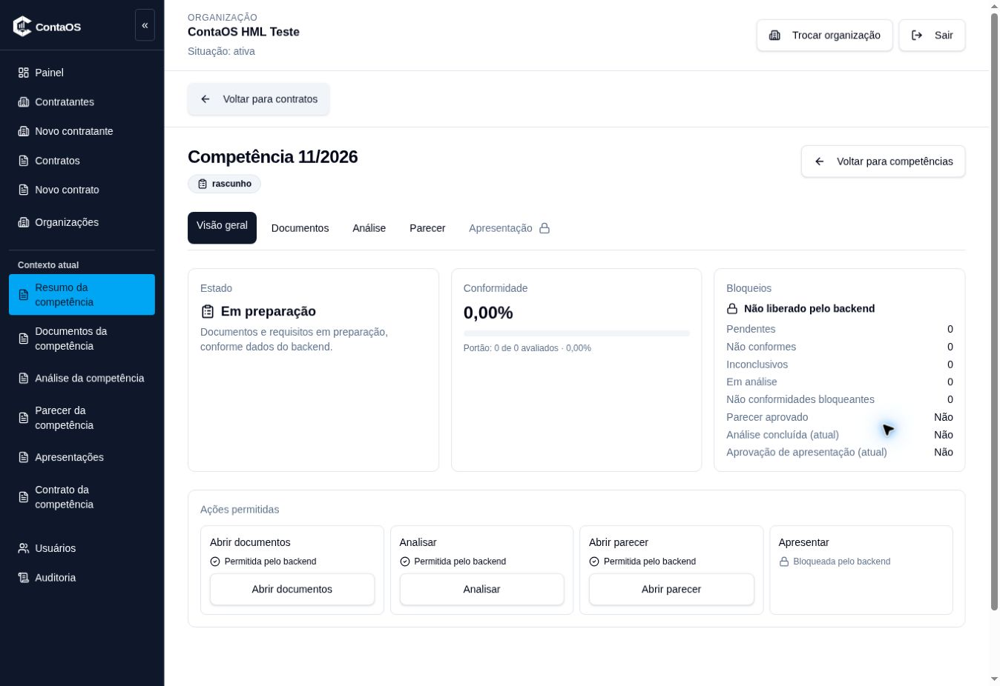

# Reteste autenticado da competência após PR330

Execução real em 08/11/2026, HML Vercel. Resultado PASS limitado à visão geral V114.

Deployment `dpl_88NzSV2gnifGoADCmT1UBjXzZd54` READY, main `95ddd9cf2a81c009ac1e2fa24165b4ec16cb295d`, alias `contaos-41-hml.vercel.app`, confirmado pelo conector Vercel. CI do head PR330 `4de706cbeaefcd5d6015a3ba5685b5e6a703ca4d`: Zero-Drift42447237649 e LOCK42447237638 SUCCESS. Correção TS4111 usa acesso por colchetes no teste, sem relaxar a configuração.

Login real por formulário seguro e seleção ContaOS HML Teste, Administrador Master. Percurso pela UI: Contratos → AUD-A-VERCEL-20261108 → Competências → 11/2026. Reutilizada competência `59072760-4420-4598-82dd-367f41a79e89`, sem nova escrita de negócio. Visão geral carregou: rascunho, Em preparação, conformidade0,00%, portão0de0. Apresentar permaneceu bloqueada pelo backend e aba Apresentação desabilitada; documentos/analisar/parecer exibidos como permitidos. Não foram executadas essas ações nesta rodada.

O erro histórico do relatório Vercel anterior está superado para esta competência neste deployment. Preservar a evidência antiga como RED; não apagar nem apresentá-la como falha atual. Screenshot e DOM em `evidencias/reteste-pr330-20261108`, SHA256SUMS. Não certifica as232combinações,72critérios,WCAG integral,CRUDglobal ouV1. Não afirma igualdade binária entre Lovable eVercel.

