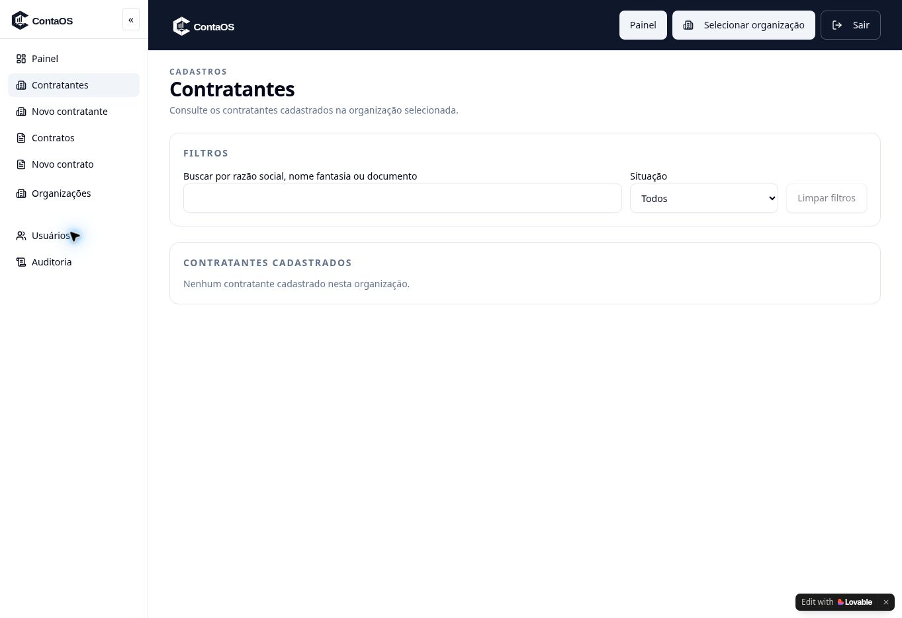
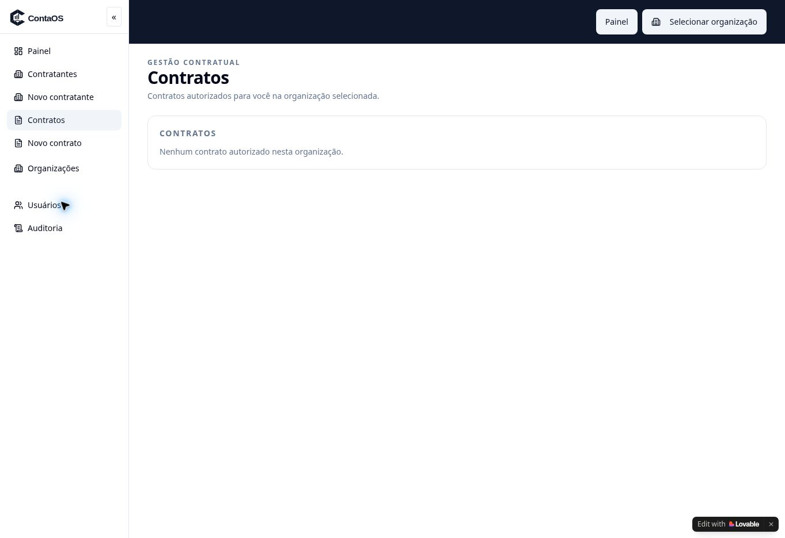
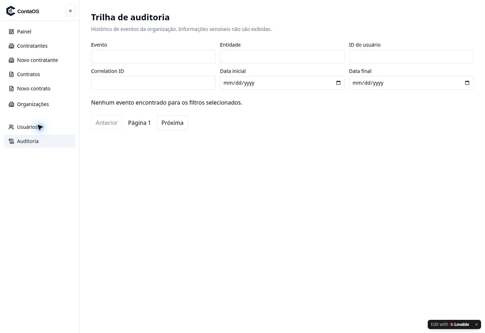

# Trilha A: execução autenticada no HML publicado

**Parecer: NO-GO. Coleta parcial executada, certificação integral pendente.**

Execução em 08/11/2026 UTC, com login real por formulário seguro, sem leitura ou registro de senha, token ou cookies. A seleção de organização apresentou o perfil Administrador Master. Foi selecionada a organização ativa **ContaOS HML Teste**. O painel e sete superfícies privadas foram acessados com essa sessão. Não houve criação de fixture, escrita de negócio, mudança de permissão, configuração Auth ou intervenção no backend.

## Proveniência

- Frontend main verificada: `45104916895a1f0972ecec2eec9a541dbd4e0b97`, merge do PR #324. Backend main consultada por Git: `765dac8aa1033f6c0ac6478738fac4ab768426e4`. Nenhuma inspeção técnica de banco foi realizada.
- Origem observada: `https://scope-and-approval-keeper.lovable.app`.
- Script do produto observado no DOM: `assets/index-CjzqjoMJ.js`.
- Metadados atuais do projeto Lovable `b113dd59-6caf-4c92-8302-457a037a0c6f`: `latest_commit_sha=935bb96e3d73f7f7d1a8585a4e677db5dd92a379`, `last_edited_at=2026-11-07T02:38:05.572Z`. Esse metadado identifica o último commit informado pelo projeto, **não prova o SHA do bundle publicado**. O SHA efetivamente publicado permanece NÃO VERIFICADO.
- Evidência adicional de divergência: a main contém `ContaOSOrganizationHeader` no AppShell, com cabeçalho `aria-label="Organização atual"`, organização e situação. As telas publicadas abaixo exibem cabeçalhos anteriores e inconsistentes. Não atribuir suas falhas automaticamente ao código do merge #324.
- Viewport CSS observado: 1363×936, tema claro. JPEGs podem ser redimensionados pelo capturador; suas dimensões reais constam no manifesto. **Não correspondem à matriz obrigatória 1440/1280/768/390 × claro/escuro.**

## Percurso e achados

| Etapa | Superfície / estado observado | Resultado da observação |
|---|---|---|
| 1 | Login e seleção de organização | Sessão legítima comprovada pela transição ao seletor com perfil e acesso posterior às rotas privadas. Credenciais não preservadas. |
| 2 | SYS05, painel vazio | Organização e situação aparecem no cabeçalho. Seis indicadores zerados e ausência de contratos visíveis. Somente este estado foi examinado. |
| 3 | V101, Contratantes vazio | FAIL visual: marca na sidebar e novamente no cabeçalho; organização/situação ausentes. Filtros e mensagem de lista vazia carregados. |
| 4 | V102, Novo contratante vazio | FAIL visual: marca duplicada e contexto organizacional ausente no cabeçalho. Formulário carregado; não submetido. |
| 5 | V104, Contratos vazio | FAIL visual: cabeçalho sem organização/situação. Nenhum contrato autorizado visível nesta organização. |
| 6 | V105, Novo contrato vazio | FAIL visual: marca duplicada e cabeçalho sem organização/situação. Formulário carregado; não submetido. |
| 7 | ADM01, Usuários e vínculos | FAIL visual: cabeçalho sem organização/situação. Lista vazia e matriz MASTER carregadas; nenhuma permissão alterada. Captura mostra apenas a parte superior da matriz, não sua extensão integral. |
| 8 | V123, Trilha de auditoria vazia | FAIL visual: ausência do cabeçalho organizacional persistente. Filtros e paginação carregados; nenhum evento encontrado. Não comprova rastreabilidade de eventos reais. |

Os achados de marca duplicada e contexto ausente são **Important**: contrariam o aceite transversal de marca exclusiva na sidebar e contexto organizacional persistente. Não certificam defeito de autenticação/RLS e não autorizam modificar backend. Os campos de data renderizaram `mm/dd/yyyy` neste navegador; sua localidade não foi configurada para pt-BR, portanto isso não é classificado como falha do produto.

## Evidências aceitas

Sete JPEGs individuais e seus DOMs saneados estão em [evidencias/auth-20261108](evidencias/auth-20261108/). [manifest.json](evidencias/auth-20261108/manifest.json) registra origem, perfil, organização, baseline e horários. [SHA256SUMS](evidencias/auth-20261108/SHA256SUMS) permite conferir os 15 arquivos do conjunto.

As capturas foram abertas e examinadas individualmente. Capturas transitórias com spinner foram rejeitadas e substituídas após carregamento. Não usar as contagens DOM intermediárias nem o lote transitório como prova. Os JPEGs aceitos mostram somente organização de teste, formulários vazios, listas vazias e matriz de permissões sem alterações.

## Cobertura e impedimentos

- **7 superfícies privadas observadas em desktop claro; 0 dos 232 casos formais certificados nesta execução.** Não somar esta amostra às provas públicas anteriores nem converter os 208 casos privados em PASS.
- A organização selecionada não expõe contratantes/contratos. Edição, detalhes, competências, documentos, análise/drawer, parecer, apresentação/protocolo e histórico não foram exercitados. Nenhum ID fictício foi usado para fingir esse percurso. A ausência de registros nesta organização não prova indisponibilidade global de fixtures.
- Não executados: quatro larguras formais, tema escuro, 72 critérios BRAND individuais, contraste medido, percurso de teclado/foco, leitor de tela, zoom nativo, mutações CRUD, upload, reset de senha, negativas RBAC/RLS e comparação de bundle com o SHA integrado.
- O executor `scripts/testc/visual-audit.mjs` continua sem sessão privada. O workflow SYS-03 `contaos-sys03-hml-authenticated.yml` apenas executa teste de pré-requisitos: a suíte declara que nunca chama Auth. Não usá-lo como comprovação de login ou N1–N9.
- O achado histórico de sobreposição de texto ampliado em SYS01 1440 claro/escuro, comentário #6716078831 no PR #324, permanece pendente de rechecagem. Esta execução autenticada não o resolve.

## Próxima tarefa comprovadamente necessária

1. Reconciliar a sincronização/publicação HML com a main integrada e provar o SHA servido. Nenhuma publicação foi realizada nesta auditoria. Evitar corrigir novamente código já integrado apenas porque a publicação está divergente.
2. Reexecutar estas sete telas na versão comprovada. Se os achados persistirem, abrir PLAN/GATE fechado antes de qualquer correção.
3. Identificar fixtures HML existentes, lícitas e adequadas aos estados restantes. Se for necessário criá-las, preparar escopo e limpeza próprios, sem reutilizar organizações em quarentena ou alterar situações para fabricar conformidade.
4. Executar e comprovar a matriz autenticada completa e os 72 critérios, preservando evidências válidas. Só então deliberar certificação visual, CRUD, integração/auditoria e V1. V2–V5 e PROD continuam bloqueados.

ZERO-DRIFT — IDENTIDADE VISUAL + ECONOMIA LOVABLE: somente documentação e evidências nesta branch. Nenhum produto, backend, workflow, dependência ou tipo congelado alterado. CI documental não equivale à homologação autenticada integral.
