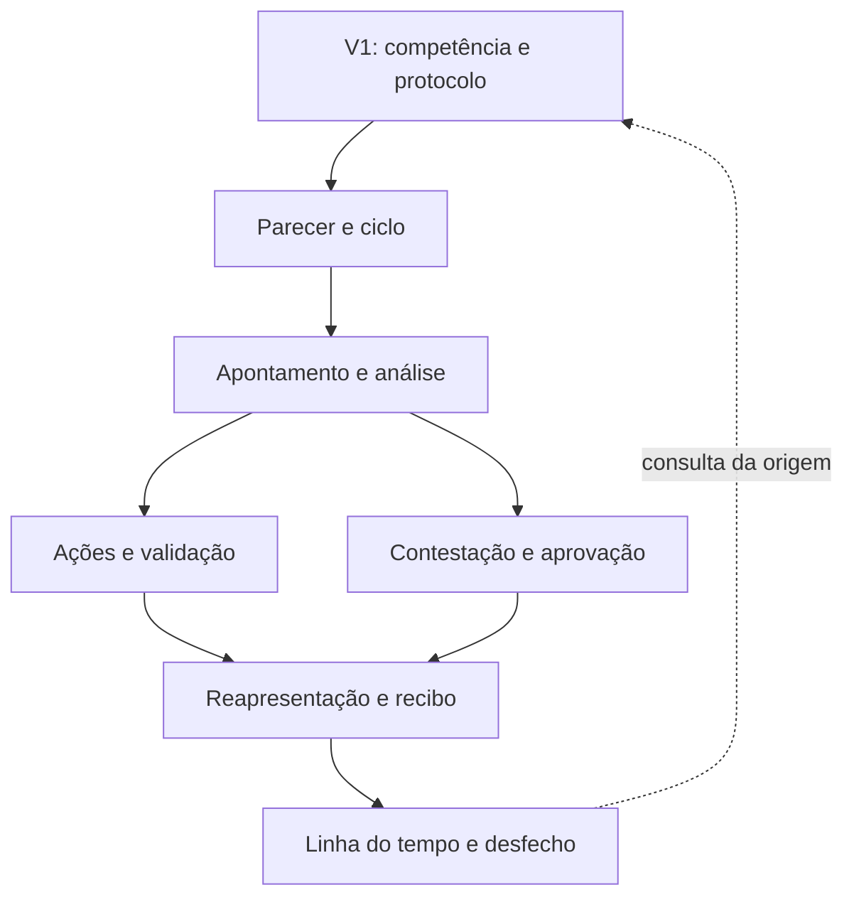

# ContaOS 4.1 — Plano executivo da V2 e da integração V1–V2

**Em 26/11/2026** · **Plano mestre documental para revisão** · **V2 PENDENTE** · **LIVE NOT_RUN** · **PROD NO-GO**

**Objetivo.** Entregar as oito superfícies da V2 e comprovar a integração interna e cumulativa. A partir de qualquer diligência, apontamento, decisão, contestação ou reapresentação, uma pessoa autorizada deve localizar a origem, a versão da evidência, os eventos intermediários e o resultado. A partir da apresentação V1, deve localizar as rodadas e os desfechos que realmente derivaram dela.

**Arquitetura.** O frontend React/TanStack usa o cliente Supabase existente e os contratos validados no HML. O backend fornece identidade, escopo, estados e decisões materiais. A matriz preserva os IDs e as versões originais da V1, registra o delta V2 e vincula cada relação às provas, ao commit e à revisão que a sustentam.

**Ordem.** Manter as 22 fases do [Plano Único V2 da PR #659](P0_V2_PLANO_UNICO_CERTIFICACAO_INTEGRACAO_CUMULATIVA_2026-11-14.md). Este detalhamento estabelece o roteiro, os cenários e os critérios dos PLANs executáveis por fatia. Cada BUILD depende da integração prévia de seu PLAN P0 fechado.

## 1. Linha de base verificada

| Item | Estado e fonte |
| --- | --- |
| Frontend | `67d663c5aef546212fca15cccdc8d6eefafa122a` na `main`. [Checkpoint oficial #708](https://github.com/contaos999999/contaos-hml-control/issues/708#issuecomment-7196031168) |
| Backend normativo e tipos | `a1516de1d8949e505d83b5e000eb1cc558b217a7` em `contaos999999/develop`. Blob protegido de `types.ts` `8ea7750b75fd9d76b29c36ce7613392e3ab65e19`. [Snapshot e verificação na origem](../CONTEXT_CANONICO_4_1_SNAPSHOT.json) |
| V1 funcional e interna CODE | Certificado histórico e consolidação global integrados. Recibo efetivo V1/interna PASS no P0, com Zero-Drift do merge. [Certificação global #821](https://github.com/contaos999999/contaos-hml-control/pull/821) · [Recibo #822](../governanca/P0_RECIBO_INTEGRACAO_INTERNA_V1_CODE.json) |
| Cobertura herdada | 27 telas de núcleo, duas auxiliares de recuperação, 138 conexões canônicas (120 obrigatórias e 18 condicionais), 1.104 provas F3–F6, oito complementares e 52 casos históricos de navegação. Inventário F1 com 577 conexões estáticas, incluindo navegação. [Inventário F1](../auditorias/integracao-funcional-v1/fase1/inventario.json) · [Matriz F7](../auditorias/integracao-funcional-v1/fase7/F7_CODE_TRACEABILITY.json) |
| Fontes da V2 | 25 blobs do contexto conferidos. O ZIP mestre, o manual dos 100 regulares e o caderno dos 97 atômicos coincidem com seus SHA-256 de referência. Conferidos os textos 44–49, 76–77 e a identidade exata 025–043. [Catálogo 100/97 na origem](https://github.com/contaos999999/develop/blob/a1516de1d8949e505d83b5e000eb1cc558b217a7/docs/prompts/PROMPT_TRACKS_4_1.json) |
| Entrada V2 | A leitura efetiva do P0 e a simulação estrutural do PLAN 44 conferem V1/interna PASS e 44 como próximo regular elegível. A V2 está PENDENTE. [Controle de ordem](../governanca/P0_PRIORIDADE_ZERO_ORDEM_POR_VERSAO_4_1.md) |

A [matriz inicial de rastreabilidade](P0_V2_MATRIZ_BASE_RASTREABILIDADE_V1_V2_2026-11-26.json) fixa 37 superfícies, os oito regulares, os 19 requisitos V2, 20 relações internas e 36 relações cumulativas, incluindo regressões de fronteira, e 14 jornadas com resultado positivo e negativo esperados. As relações V2 e cumulativas desta matriz estão pendentes de execução. O universo final de relações é reconciliado com os contratos e o diff efetivamente entregues.

## 2. Sequência dos oito PLANs

| Regular e superfície | Entrada e acesso | Entrega com origem e destino | Casos de aceite |
| --- | --- | --- | --- |
| **44 · V2-01 Diligências** | `/competencias/:id/diligencias`. Acesso à competência | A partir da V114, listar ciclos da competência com situação, prazo e retorno ao mesmo contexto. Ativar a abertura de ciclo junto com a entrega da 45. | J01, J02, J03, J05, J13 |
| **45 · V2-02 Ciclo de diligência** | `/diligencias/:cicloId`. Acesso ao ciclo | Abrir a rodada exata, com parecer de origem, prazo, apontamentos, classificação e valores por natureza. Reconciliar o estado com a lista V2-01. | J01, J02, J04, J05, J09 |
| **46 · V2-03 Apontamento, detalhe** | `/diligencias/:cicloId/apontamentos/:id`. Acesso ao item e à revisão permitida | Expor fonte original, sugestão, decisão humana e versões de evidências. Voltar ao ciclo e abrir apenas as origens autorizadas de V1. | J04, J06, J07, J08, J11 |
| **47 · V2-04 Plano de ação** | Painel/modal no apontamento. Responsável e revisor | Vincular tarefas, tipos, prazos, dependências e nova prova ao item. Relê-lo após a decisão oficial de validar a solução. | J05, J07, J09, J12 |
| **48 · V2-05 Contestação** | Painel/modal no apontamento. Jurídico/aprovador segundo a ação | Apresentar recomendação assistida, minuta, mapa de evidências, versão e aprovação humana. Levar a versão aprovada ao portão da rodada e o desfecho à linha do tempo. | J06, J08, J09, J11, J12 |
| **49 · V2-06 Wizard de reapresentação** | `/diligencias/:cicloId/reapresentar`. Aprovador | Avaliar portão oficial, congelar pacote, registrar protocolo e reler recibo. Confirmar situação da competência e preservar a apresentação anterior. | J02, J09, J10, J12 |
| **76 · V2-07 Pareceres do contratante** | Rota proposta `/competencias/:id/pareceres-contratante`. Acesso por operação | Receber, classificar e vincular arquivo privado à apresentação exata. Acompanhar extração, prazo e falhas. Integrar a entrada com V2-01, V2-02 e V2-03. | J02, J03, J04, J05, J12 |
| **77 · V2-08 Linha do tempo externa** | Rota proposta `/competencias/:id/linha-do-tempo-externa`. Consulta autorizada | Reconstruir apresentações, rodadas, pareceres, reapresentações e desfechos com ordenação estável e navegação à origem. Expor a linha do tempo dentro do escopo de acesso do usuário. | J02, J10, J11, J12, J13 |

As quatro rotas e os dois painéis são definidos no manual. Os PLANs 76 e 77 confirmarão as duas rotas propostas e seus pontos de entrada. A matriz liga cada regular aos atômicos e aos casos, aos critérios originais do manual e aos caminhos prospectivos de rota, componente, adaptador, testes e integração. Qualquer caminho existente adicional entra na allowlist exata do PLAN antes do BUILD. Para ajuste de rota, incluir o `src/routeTree.gen.ts` gerado e executar GOV-020.

**Fatiamento.** 44 → 45 → 46 → 47 → 48 → 49 → 76 → 77. Em cada fatia, ativar links apenas para destinos que já existam. Nas fatias 44–49, a entrada de dados que depende da 76 é demonstrada com contratos e fixtures identificados. A integração da entrada V2-07 é provada ao entregar a 76 e reconfirmada em conjunto, incluindo o percurso da 77, antes dos certificados.

**Contratos prospectivos.** Reutilizar o cliente Supabase e as estruturas de leitura/validação do frontend. Cada GATE confirma fonte, permissão, cardinalidade, parâmetros, retorno, transação e prova por operação, além da disponibilidade de Data API/RLS e dos RPCs autorizados. Os nomes presentes no blob de tipos são indícios versionados e devem ter sua disponibilidade e semântica confirmadas antes de autorizar a fatia.

| Fronteira | Âncora versionada e condição |
| --- | --- |
| Parecer, ciclo e item | `pareceres_contratante.id_apresentacao/id_ciclo/id_arquivo`, `ciclos_diligencia`, `apontamentos_contratante` e `registrar_parecer_contratante`. Confirmar o vínculo de **cada item** à fonte quando o ciclo tiver vários pareceres, o mecanismo oficial de extração e os estados. |
| Análise, plano e tarefa | `analises_apontamentos`, `planos_acao`, `tarefas_diligencia`, `atualizar_tarefa_diligencia`, `concluir_tarefa_diligencia` e `revisar_solucao_tarefa_diligencia`. Registrar revisão e validação pelo contrato canônico comprovado para cada comando. |
| Contestação | `contestacoes` e `mapas_evidencias_contestacao`. Conferir `criar_contestacao`, `solicitar_minuta_contestacao`, `aprovar_contestacao` e `registrar_desfecho_contestacao`. Confirmar como mapa, hash e versão se tornam elegíveis para aprovação. |
| Portão e nova apresentação | Conferir `avaliar_portao_reapresentacao`, `liberar_reapresentacao`, `registrar_reapresentacao`, `pacotes_reapresentacao` e `apresentacoes_contratante`. Demonstrar como a nova rodada é ligada ao pacote e como seu protocolo é relido. Confirmar a leitura V120 quando ela for a fonte oficial do recibo. |
| Desfecho, precedentes e eventos | `desfechos_apontamentos`, `precedentes` e `eventos_auditoria`. Confirmar vínculo a fonte, item, versão, autoria e horário. Os acoplamentos com superfícies próprias de versões posteriores ficam registrados no catálogo de dependências para seus gates. |

Se o contrato documentado divergir do HML, a fatia dependente fica PENDENTE ou NO-GO, com operação, evidência, impacto e decisão necessária. Uma lacuna de backend segue a ADR-DEV-002 e um PLAN próprio após a autorização específica do titular. Nada no plano mestre altera `PLANO_ATIVO.json`, executa um fluxo LIVE ou autoriza mutação em backend.

## 3. Integração de ponta a ponta e rastreabilidade

| Fronteira V1–V2 | Resultado que precisa ser comprovado |
| --- | --- |
| SYS01–SYS05 e ADM01 | Entrada, recuperação, sessão, organização e vínculo. Cada expansão carrega escopo efetivo e restaura navegação sem reusar dado de sessão revogada. A recuperação testa a fronteira de autenticação. |
| V101–V106 | Contratante e contrato são chaves persistentes. Cadastros e edições da V1 formam o perímetro e preservam vínculos históricos. V106 chega à competência; a matriz explicita onde cabe regressão em vez de link direto. |
| V107–V111 | Norma/regra, rubrica e prova documental carregam vigência, ID, página/dado e versão. A análise da V2 reabre a versão citada e diferencia conteúdo da apresentação original de complemento posterior. |
| V112–V118 | A competência preserva contrato e organização. V114 é entrada e retorno. Documentos, análise, requisito e parecer interno entram como fontes no escopo e na versão em que realmente sustentaram a decisão. |
| V119–V120 | A apresentação e o pacote da V1 são a origem do parecer e da cadeia cumulativa. A V2 retorna à mesma rodada antiga e registra a nova separadamente. O protocolo da rodada anterior permanece reconstruível. |
| V121–V123 | Usar histórico/precedente com origem, competência, desfecho e vigência. Vincular eventos materiais de V2 à trilha V123, com leitura por escopo. Separar registo de importação, desfecho do contratante e sugestão de revisão. |

**Reconciliação por relação.** Para cada superfície, enumerar URLs e painéis, acionadores, eventos, leituras, mutações, consumidores, estados e campos derivados. Cruzar o catálogo normativo, o inventário V1, os contratos evidenciados e o diff. Classificar cada ligação como obrigatória, condicional aplicável, regressão ou N/A fundamentada. A direção da navegação pode diferir da direção de produção do dado. A matriz registra ambas quando existem e usa caminho indireto quando ele é a dependência real.

**Registro obrigatório de uma aresta.** ID estável, tipo e direção, chaves de organização/contrato/competência, entidade e versão de origem, produtor e consumidor (rota/componente/operação), condição de aplicabilidade, regra e vigência, perfil/ação permitidos, invariantes, dependências de cache e pontos de auditoria. Associar requisito/regular, fonte, caso positivo e negativo, estado, artefato, SHA-256, PR, HEAD, árvore, run, tentativa e job. Justificativa de N/A também tem fonte e revisão.

**Registro obrigatório de um fato material.** Identificar a entidade e o ID, os predecessores e sucessores verdadeiros, timestamp, ação, ator autorizado, correlação, versão e projeção do antes/depois por contrato. Arquivo privado, página/dado e hash são ligados por referências autorizadas. Eventos de IA registram quando aplicável modelo, versão do motor, hash da entrada, saída estruturada, estado e revisão humana. O navegador usa vínculos do backend e aplica os mesmos limites na navegação direta e regressiva.

**Identidade de uma rodada.** Identificar a competência, apresentação inicial, pacote congelado e ciclos que efetivamente derivaram dela. Manter IDs distintos de documento, versão, parecer, apontamento, tarefa, contestação, pacote de reapresentação, novo protocolo e desfecho. Em empate temporal, usar a ordenação estável do contrato e um identificador canônico como desempate. Reprocessamento ou evento tardio mantém o fato e sua origem.

**Consulta e propagação.** Isolar cache e requisições por sessão, organização e entidade. Cancelar ou descartar respostas do contexto anterior. Depois de uma mutação confirmada, reler o estado oficial e invalidar consumidores pelo mapa de impacto. Em ausência, dados incompletos, bloqueio de acesso, erro, processamento ou conflito, exibir o estado próprio que o contrato permite comprovar e preservar o foco.

**Portão.** Provar com um item pendente, uma contestação sem revisão, uma tarefa concluída sem solução validada e uma evidência atualizada após aprovação. Esses estados bloqueiam quando o contrato os define como impeditivos. A liberação exige 100% dos apontamentos da rodada tratados, soluções validadas e contexto/reanálise atual. A decisão final de validar a competência é do contratante. Sugestão, minuta, aceite interno, reapresentação e desfecho são eventos distintos.

## 4. Fases, entregáveis e condições de saída

| Marco e fase | Entrega verificável na ordem de execução |
| --- | --- |
| **I.1 · Baseline** | Reancorar os dois HEADs, 25 fontes, manual/caderno, recepção da V1, matriz inicial das 37 superfícies e testes de controle. Rastrear divergência de rota ou requisito antes de consolidar a fonte. |
| **I.2 · Contratos** | Para a fatia elegível, obter o GATE de compatibilidade com operação, implementação comprovável, autoridade, origem, tipos, erros, RLS, arquivo/Queue e critérios. Repetir o delta do GATE antes de cada BUILD. |
| **I.3 · Entregas por tela** | Executar os oito incrementos na ordem da seção 2. Para cada um, integrar PLAN P0 com escopo exato, executar RED/GREEN/negativos/regressão, integrar BUILD com revisão e confirmar o recibo do regular antes do seguinte. |
| **I.4 · Segurança** | Consolidar matriz papel × recurso × ação × organização. Provar negação, revogação, escopo, separação de papéis, controles de acesso e ausência de segredo no modo CODE. |
| **I.5 · Qualidade visual** | Teste C do checkout aprovado, em 1440/1280/768/390 nos dois temas, com teclado, foco, labels, mensagens PT-BR, estados, responsividade e capturas. Incluir painel V2-04 e V2-05, e os consumidores V1 alterados. |
| **I.6 · Jornadas funcionais** | Executar os critérios originais dos oito regulares, os 19 atômicos, BRAND-01 e NFRs aplicáveis com provas positivas e negativas. Vincular os resultados aos 14 grupos de jornadas e aos casos descobertos na análise. |
| **I.7 · Revisão e atestação** | Reproduzir o conjunto do mesmo HEAD, conferir proveniência, hash e conteúdo, promover o material atestado e registrar revisão técnica assistida pré-PROD. |
| **I.8 · Certificado A** | Integrar certificado funcional CODE com os sete recibos de fase, matriz, grafo e prova visual final. Ativar o recibo e verificar na main. |
| **II.1 · Inventário interno** | Reconciliar oito superfícies V2 com rotas reais, painéis, contratos, produtores/consumidores e arestas distintas. Gerar matriz e grafo internos. |
| **II.2 · Navegação** | Percorrer menu, rota direta, retorno, recarga, identificação da rodada, painéis e transições de sessão nos perfis do CODE_FIXTURE. Conferir Teste C desktop e mobile. |
| **II.3 · Relacionamentos** | Validar identidade, cardinalidade e ausência de órfãos em parecer, ciclo, item, tarefa, contestação, pacote e desfecho. Confirmar todas as chaves de contexto. |
| **II.4 · CRUD e sincronização** | Exercitar operações permitidas e releituras dos consumidores, cache, transação, concorrência, reenvio e resposta atrasada. Validar preservação dos snapshots. |
| **II.5 · RBAC/RLS** | Confrontar atos permitidos/negados por papel e escopo, incluindo rota direta e tentativa de comando sem a autoridade necessária, conforme contrato e provas CODE. |
| **II.6 · Jornadas internas** | Executar as provas por aresta aplicável com sucesso, falha e retomada. Verificar diagnóstico, efeito único, auditoria e limpeza das fixtures. |
| **II.7 · Certificado B** | Integrar certificado interno V2 CODE com seis recibos anteriores, matriz e grafo internos, revisão, autenticação e Teste C final. |
| **III.1 · Inventário cumulativo** | Vincular as 29 superfícies V1 e oito V2 às dependências reais. Reconciliar 138 casos canônicos herdados, 56 relações iniciais novas ou de fronteira e o delta descoberto. Usar o artefato V1 como âncora sem renumerá-lo. |
| **III.2 · Integridade de objetos** | Provar organização → contrato → competência → apresentação original → parecer/ciclo → item/prova, com versões e hashes corretos. Validar observação de rodada e nenhuma troca de origem entre apresentações da mesma competência. |
| **III.3 · Fluxos ponta a ponta** | Executar ingresso a partir da V1, trajetos internos da V2 e consulta regressiva à fonte. Combinar correção, contestação, decisão externa e nova rodada nos casos aplicáveis. |
| **III.4 · Sincronização e histórico** | Provar que os consumidores V1 autorizados refletem a reapresentação e o desfecho, com a prova original consultável. Comparar snapshots antes/depois e comportamento com concorrência e recuperação. |
| **III.5 · Segurança cumulativa** | Aplicar RBAC/RLS nas duas direções. Testar vínculo cruzado, escopo de arquivo/evidência e trilha restringida. Registrar contraprovas LIVE no GATE PROD. |
| **III.6 · Linhagem e regressão** | Reconstruir cada objeto e a direção de leitura pelos IDs, versões e eventos. Rodar 138 casos canônicos V1 com 276 provas no candidato cumulativo, manter os oito complementares e conferir os fluxos de navegação CODE afetados. Os 52 casos históricos da F2 continuam ancorados no ambiente original. |
| **III.7 · Certificado C** | Integrar certificado cumulativo V1–V2 CODE com seis recibos, grafo, matriz, Teste C, revisão e autenticação na main. O P0 somente libera V3 após reconhecer A, B e C. |

### Ciclo obrigatório por regular

1. Confirmar o próximo regular pelo P0 efetivo e anexar o crosswalk literal, incluindo 000 e os atômicos diretos. Localizar os contratos, seus consumidores, os riscos de V1 e os casos derivados.
2. Preparar PLAN P0 com allowlist de caminhos exatos, RCA, risco/impacto, plano de rollback, critérios do manual, testes e comprovantes. Vincular o PLAN executável ao `PLANO_ATIVO.json` e à ficha `docs/frontend/rca/P0_RCA_ATIVO.json` nos marcos exigidos pelos gates. Integrar o PLAN validado antes do BUILD.
3. Reproduzir o comportamento ausente ou falho no RED, demonstrar a causa quando for correção e implementar apenas a fatia. Em seguida executar GREEN, negações, regressão por consumidor e suite integral.
4. Verificar no GitHub base viva, PR, HEAD, árvore, tentativa e todos os checks. Registrar a revisão assistida por Edivan5002 no HEAD exato, fazer o merge protegido e ler os blobs na main.
5. Emitir recibo do regular com material verificável e avançar a sequência apenas quando o P0 reconhecer esse recibo. Registrar o checkpoint com a próxima tarefa e as pendências legítimas.

### Rito P0 de governança da progressão

O manifesto histórico P0-LOCK-CERT e a camada de recibo V1 autenticada são âncoras da certificação. Antes de registrar a conclusão do 44, validar em um PLAN técnico próprio como ambos os leitores do P0 reconhecerão os oito recibos sequenciais e depois os três certificados V2, preservando o manifesto ancorado da V1. A extensão aditiva da leitura é a opção prevista. Sua validação deve rejeitar salto de regular, prova fora do HEAD, certificado antecipado e abertura V3 sem o conjunto completo. A ordem dos 100 regulares e 97 atômicos, a proteção de branch e o gate PROD permanecem vinculantes.

A prova visual terminal segue o contrato da PR #823. Planejar a extensão de Teste C com as oito superfícies reais da V2 e seus consumidores V1, fixtures e isolamento aprovados, afirmações visuais e capturas em quatro larguras e dois temas. Usar o executor Teste C existente, checkout exato e um PLAN de governança fechado para os caminhos impactados. Uma execução documental que apenas omitiu Playwright não comprova o Teste C. Cada certificado precisa de prova final no HEAD ou merge reconhecido pelo gate de origem.

## 5. Segurança e requisitos não funcionais

| Escopo | Provas a planejar |
| --- | --- |
| 000, BRAND-01, acessibilidade e GOV-020 | Preservar identidade, navegação, assets e componentes oficiais. Provar foco, teclado, rótulos, anúncio de estado, contraste, tabelas mobile e todas as larguras/temas. Conferir árvore de rotas gerada e limpa. |
| 085 e 086, escala e pooling | Validar concorrência e isolamento de estado em CODE, documentar contrato e evidência operacional aplicável. Vincular capacidade real a ensaio autorizado, com carga e limites definidos previamente. |
| 087 e 088, Storage privado e retomada | Provar interfaces, expiração/autorização, erros, limpeza, integridade e retomada com transporte sintético. Vincular a contraprova física ao GATE PROD. |
| 089 e 090, assincronicidade e filas | Exercitar processamento separado, backoff, duplicação e falha isolada, recuperação e timeout. Vincular worker e filas reais ao GATE PROD. |
| 091 e 092, concorrência e idempotência | Duas requisições concorrentes, versão obsoleta, reenvio após commit e idempotência da transação. Exigir um efeito confirmado ou conflito tratado. |
| 093 e 094, paginação e observabilidade | Limite e cursor segundo o contrato, ordenação estável e releitura por escopo. Correlation ID e eventos nos fluxos materiais, sem JWT, chave de serviço ou conteúdo privado em logs, URLs ou artefatos. |
| 095 e 096, resiliência e carga | Falha de terceiro, degradação, retry delimitado e testes de volume com massa sintética. Medir baseline e definir limiares do ensaio com fonte antes da execução. Preservar o ensaio de carga real aplicável ao gate operacional. |

**Foco da revisão.** Cruzar pares de organização e contrato (J01/J03), evidência incluída depois do protocolo (J06), tarefa concluída sem solução validada (J07/J09), concorrência e perda de resposta após commit (J10), e evento tardio ou de tempo empatado na linha do tempo (J11). Verificar negações, ausência de escrita em estados inadequados, preservação de histórico e leitura sem divulgação de informações.

**P0-NR e rollback.** Antes de alteração, confrontar o ledger e a hipótese causal. Priorizar NR-003 (subteste realmente selecionado), NR-004 (Playwright e capturas executados), NR-005 (allowlist causal), NR-006/007 (proveniência e prova material), NR-008 (causa e delta por revisão) e NR-009 (base viva). Se um BUILD falhar, isolar o defeito, preservar os dados já gravados e o checkpoint, corrigir por novo HEAD. Se necessário, reverter por PR protegido e reavaliar dependências, sem reescrever histórico ou versões de evidência. Testar ausência de efeito duplicado e rollback do frontend em CODE.

**ZERO-DRIFT — IDENTIDADE VISUAL + ECONOMIA LOVABLE (OBRIGATÓRIO).** Usar GitHub como fluxo canônico. Reutilizar o design, o adaptador Supabase e os testes com origem válida. Gates por BUILD incluem LOCK-TYPES, P0-RCA, P0-NR, Zero-Drift, lint, typecheck, build canônico, testes focados, regressão integral, segurança, GOV-020 quando aplicável e Teste C material. O Teste C deve operar em leitura controlada, com dados sintéticos autorizados e serviço/backend preservado.

## 6. Certificação, evidência e encerramento

| Recibo P0 | Certificado final previsto | Conteúdo mínimo |
| --- | --- | --- |
| **A · Funcional V2** | `docs/frontend/auditorias/certificacao-funcional-v2/fase8/CERTIFICADO_V2_FUNCIONAL_CODE.md` | Oito regulares, 025–043, BRAND-01, 12 NFRs avaliados e sete recibos anteriores. Matriz, grafo, resultados executados e Teste C final. |
| **B · Interna V2** | `docs/frontend/auditorias/integracao-funcional-v2/fase7/CERTIFICADO_V2_INTEGRACAO_INTERNA_CODE.md` | Oito superfícies, todas as arestas aplicáveis internas, seis fases anteriores, resultados positivos e negativos, matriz, grafo e Teste C final. |
| **C · Cumulativa V1–V2** | `docs/frontend/auditorias/integracao-cumulativa-v1-v2/fase7/CERTIFICADO_V1_V2_INTEGRACAO_CUMULATIVA_CODE.md` | Linhagem de ida e volta, 37 superfícies, regressão V1, seis fases anteriores, matriz, grafo e Teste C final. |

Usar uma PR protegida por certificado com fontes de fase, matriz, grafo e hashes no escopo do respectivo caminho. O ledger registra ID do caso, polaridade, valor esperado, resultado assertado, condição, HEAD, árvore, CI, tentativa, job, artefato e SHA-256 do ZIP e membros. Conferir origem, revisão no HEAD, ancestralidade do merge, validade do artefato e assinatura de proveniência. Comparar byte a byte o material oficial, a reprodução e a versão promovida antes da ativação do recibo.

Cada superfície, regular, atômico aplicável e aresta obrigatória ou condicional aplicável tem uma prova explícita e rastreável. Para a certificação, exigir cobertura completa dessas relações, sem falha, bloqueio, ausência de resultado ou skip no universo aplicável. O denominador sai da matriz reconciliada, com exclusões justificadas auditáveis. O número inicial de relações deste plano é referência de trabalho. Alteração de contrato, escopo ou grafo exige reconciliar inventário, resultados e impactos. As provas históricas são autenticadas no próprio SHA e reutilizadas com análise de impacto.

No fechamento, ler os três recibos pelo P0 efetivo da `main` e confirmar CODE_CERTIFICATION, blobs, pais, árvore e CI do merge. Registrar na issue #708 as três PRs, revisões, checks, contagens, artefatos, decisão e próxima versão elegível. A simulação de abertura da V3 requer o conjunto A+B+C e a cadeia V1 válida.

A [regra CODE/LIVE da PR #718](https://github.com/contaos999999/contaos-hml-control/pull/718) situa as contraprovas operacionais no GATE PROD após a V5. Upload físico e retomada, worker e filas reais, isolamento autenticado entre usuários/organizações e demais verificações LIVE aplicáveis ficam registrados nesse gate, com seus requisitos de autorização. Estado desta entrega documental e dos certificados da V2: **LIVE NOT_RUN · PROD NO-GO**.

**Próximo marco.** Abrir o PLAN P0 executável do Prompt 44 com a rota Diligências, a integração de entrada V114, o contrato evidenciado de leitura dos ciclos e o escopo fechado extraído da matriz inicial.

Para a 44, os testes focalizados devem exibir ciclos de duas rodadas da competência A no ordenamento do contrato e navegar de V114 até a lista e de volta. A contraparte usa outro usuário/organização, ID de competência incompatível e uma resposta atrasada após troca de sessão. Nenhum ciclo cruzado deve aparecer. Exercitar também carregamento, lista legitimamente vazia, indisponibilidade e erro de acesso. Se o contrato e a autorização não se confirmarem no GATE da fatia, registrar a pendência e manter o BUILD 44 bloqueado.
